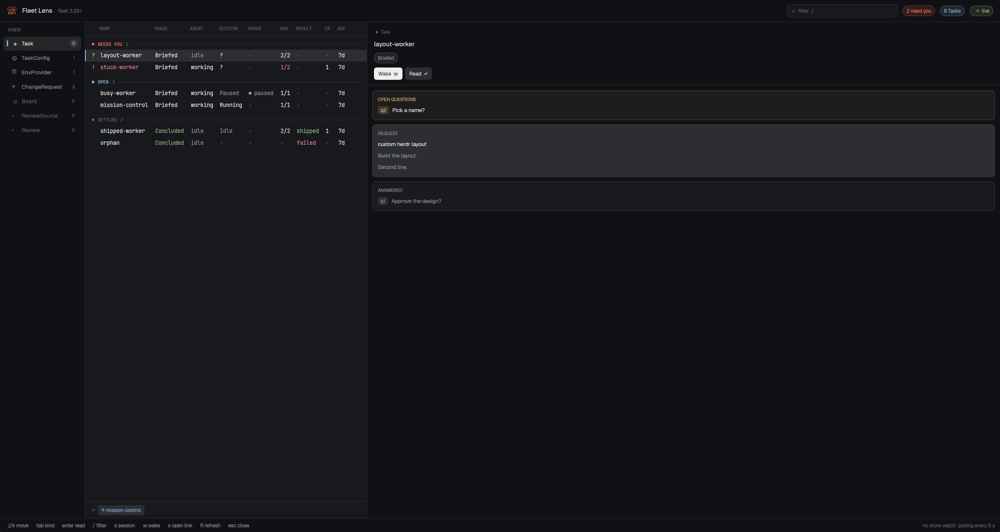

# Fleet Lens

A keyboard-first float that browses every resource a [Fleet](https://github.com/Thurbeen/thurbox/tree/main/docs/fleet) store holds, plus a `fleet` layout. In that layout, Herdr's Agents list becomes a **Fleet Sessions** list, which shows every Task's session, live or paused, and wakes paused ones. It is the Herdr counterpart of [thurbox-fleetlens](https://github.com/Thurbeen/thurbox-fleetlens).

## What you see

**The Lens** is a dialog at 92% of the window's width and 90% of its height. Open it from the palette entry "Fleet: open Lens" (`mod.open {name: "fleet-lens"}`) or from the sidebar's Lens button.

- **Header** (52px, `chrome` background):
  - On the left: the Thurbeen mark (24px), "Fleet Lens" at 15px semibold, `fleet <version>` dimmed, and a braille spinner while loading.
  - On the right: a 260px filter field (`⌕ filter  /`), then pills. "N need you" in `blocked`. "N Tasks" (or "N of M" while filtering) in `accent`. A green "live" pill with a pulsing dot when the store is watched ("polling" otherwise, "◌ stale" in red on an error).
- **Kinds rail** (200px, `chrome`):
  - It lists "KINDS": the core kinds from `fleet version --json`, Task first, then each kind a plugin serves from `fleet list plugins --json`.
  - Each row has a glyph (◆ Task, ⚙ TaskConfig, ⚿ EnvProvider, ⑂ ChangeRequest, ✉ Conversation, ◎ Listener, ◷ CronTask, ▤ Board, • anything else), the kind name and a count.
  - The selected kind has a 3px accent bar, a `selected` background and an accent count chip. Kinds with a count of 0 are dimmed.
- **Table** (monospace, the terminal font):
  - Columns per kind:
    - Task: `NAME PHASE AGENT SESSION HERDR GEN RESULT CR AGE`
    - ChangeRequest: `NAME CHANGE PHASE COND SYNC AGE`
    - Every other kind: `NAME PHASE COND SYNC AGE`
  - Column widths come from the content, with NAME capped at 44 characters.
  - Rows are grouped under section lines with counts: NEEDS YOU (`blocked`), OPEN (`accent`), SETTLED (`dim`).
  - A 20px marker column shows `!` (NeedsAttention, `ansi1`) or `?` (an unanswered Question, `ansi3`).
  - The selected row has a 2px accent left border and a `selected` background.
- **Cell tones:**
  - `ansi2` for settled phases and shipped results, `ansi3` for stuck, `ansi1` for failed and for a GEN where the brief lags the spec. Muted for idle agents and paused or idle sessions.
  - The HERDR cell shows a dot plus the live Herdr agent status of the Task's terminal (working dots pulse), or "paused" when Fleet paused the session.
- **Trail** (under the table): "→" and accent chips for what the row names: its TaskConfig, its declared resources, `↑ parent` and `↓ child` Tasks.
- **Preview pane** (fills what the table leaves, at least 440px; hidden below that):
  - The kind, the name at 15px, and a phase pill plus a "herdr <status>" pill.
  - Buttons: "Go to session s" or "Wake w" (solid), "Open link o", "Read ↵".
  - Cards with tinted backgrounds:
    - NEEDS ATTENTION (red)
    - OPEN QUESTIONS (yellow): every question, with its id badge and full wrapped text
    - REQUEST: the `vega.fleet.dev/request` label, then the first six lines of the brief, dimmed
    - RESULT: tinted by outcome, with an outcome pill, the summary and `↗ owner/repo#N` links
    - CHANGE REQUESTS
    - ANSWERED (muted)
  - Other kinds show a CONDITIONS card.
  - When the preview is hidden, a tinted "why" strip under the table repeats the marker's reason.
- **Detail view** (Enter):
  - The title is `Kind/name`, then "yaml · line N of M".
  - Below it is the whole object as YAML: envelope first (apiVersion, kind, metadata, spec, status), then other keys sorted, with block strings for multi-line text and quotes for ambiguous strings.
  - Line numbers are 48px wide. Keys are `accent`, numbers and booleans `ansi5`, null and empty values dimmed, and URLs `accent`. The cursor line has an accent border.
- **Footer** (32px): clickable hints, "j/k move · tab kind · enter read · / filter · s session · w wake · o open link · R refresh · esc close", and on the right "watching <store>" or "no store watch: polling every 5 s".

**The Fleet Sessions sidebar** sits in the `fleet` layout, in place of Herdr's `agents` block.

- At the top: the Thurbeen emblem (20px tall) and a "Lens ◈" button.
- Below that: "FLEET SESSIONS N", then collapsible groups. NEEDS YOU (`blocked`), LIVE (`accent`) and PAUSED (muted) are open; SETTLED (`dim`) starts collapsed.
- Each row shows:
  - A state mark: a dot coloured by Herdr status (working pulses), two 2×8px bars for paused, a braille spinner while waking.
  - The Task name; paused and stopped names are muted.
  - Badges: `?`/`!`, the outcome for finished paused sessions, and `mux` for sessions on a `mux/…` host. A Task on a plain `local` host counts as herdr when a herdr-core terminal carries its session id.
  - A "Wake" button on paused rows.
  - The row of the space you're in is highlighted.

## How it behaves

- **Agent states:**
  - working: a pulsing dot (`working` colour)
  - blocked: a `blocked` dot, and the Task joins NEEDS YOU
  - done: a `done` dot
  - idle: an `idle` dot
  - paused: bars, or "paused" in the HERDR column
  - waking: a spinner, and "Waking…" in the preview button
- **Sort order:** rows that need a person first, then open work, then settled. Newest first within each.
- **Lens keys:**
  - `j`/`k`/arrows move.
  - PgUp/PgDn move ten rows.
  - `g`/`G`/Home/End go to the first or last row.
  - `tab`/`shift-tab` or `ctrl-l`/`ctrl-h` change kind.
  - Enter reads the row, and Enter or Esc goes back.
  - `/` filters by name or request label: typing edits the filter, Backspace deletes, Enter keeps it, Esc clears it.
  - `s` goes to the session, `w` wakes it, `o` opens the row's link, `shift-r` refreshes.
  - Esc or `q` closes the Lens; a filter is cleared first.
- **Lens clicks:** clicking a kind selects it. Clicking a row selects it; clicking it again, or double-clicking, reads it. Trail chips follow the link. Footer hints act like their keys.
- **Going to a session:**
  - A live herdr session gets `agent.focus` and the Lens closes.
  - A paused session (any runtime), or a herdr session whose terminal is gone, is woken with `fleet attach <task> --json --wake` (180 s timeout). When its new terminal appears, it gets focus.
  - Notifications report success or the error.
  - A live session on another runtime (mux) has nothing to open; its row is not clickable.
- **Refresh:** whenever `<store>/objects` changes (`watchFolder`), and every 30 s, or every 5 s without a store. Timers skip while the window isn't visible.

## Built from

- **Layout** `layouts/fleet.json`: Herdr's `main` tree, with its `agents` block replaced by `{"id": "fleet-sessions", "content": {"mod": "fleet-lens", "props": {"view": "sessions"}}}`. The shipped `spaces`, `tabs`, `pane`, `files`, `changes`, `workspace-chrome` and `workspace-status` mods are used as they are.
- **Mod** `mods/fleet-lens/`. `props().view === "sessions"` renders the sidebar; anything else renders the Lens.
  - `main.js`: state, data loading, key and click handling, session actions.
  - `model.js`: pure. Rows, columns, tones, markers, sections, filter, preview cards, links, relations.
  - `sessions.js`: pure. Paused detection, runtime kind, go/wake plan, sidebar groups, `fleet attach` parsing.
  - `source.js`: pure. CLI commands and result parsing, the plugin kind merge, the URL opener per platform.
  - `keys.js`: the key map and footer hints.
  - `yaml.js`: the YAML renderer.
  - `view.js`: Lens UI.
  - `sidebar.js`: Sessions UI.
  - Art: `thurbeen-mark.png` and `thurbeen-emblem.png`.
- **`herdr` API:** `exec`, `terminals`, `focused`, `props`, `run` (`agent.focus`, `mod.open`), `closeOverlay`, `notify`, `watchFolder`, `readTextFile`, `appHome`, `window`, `theme`, `settings`, `nextCommand`, `checking`.
- **Programs:** `fleet version --json`, `fleet list plugins --json`, `fleet list <kind> --json`, `fleet attach <task> --json --wake`, and `xdg-open` / `open` / `cmd /c start` for links.
- **Join:** Fleet's herdr runtime labels each Task's terminal `fleet.key=<status.session.id>` (the runtime's `keyPrefix`, then the uid), and `herdr.space` with the same value. Join on the session id, never on a hardcoded prefix. A Task is paused when its `Paused` condition is True or its `sessionState` is `Paused`.
- **Config:** `install.sh --store <data.dir> --bin <fleet>` writes `mods/fleet-lens/config.json` (`{"store": …, "bin": …}`). `store` is what the mod watches. `bin` replaces `fleet` in every command.
- **Commands:** `nextCommand()` maps `fleet-lens.<action>` to the same actions as the keys (`down`, `up`, `first`, `last`, `nextKind`, `prevKind`, `open`, `back`, `close`, `refresh`, `session`, `wake`, `openUrl`, `filter`). Only the Lens copy acts on them; the sidebar copy takes only `focus`. `demo/record.sh` drives the clip with them.

## Watch out

- `init`'s first argument is not the block's props: read `props()`.
- `h_flex` centres its children. The body row needs `items_stretch()`, or the rail floats and the table collapses to zero height.
- Wrapping text in the preview needs `min_w(0)` on each flex child and container.
- Herdr's SVG renderer may lack the logo's fonts, so use the PNG renders.
- A runtime-mux session can't be shown. Its `fleet attach` stream is runtime-mux's framed viewer protocol, not a TTY. Attaching to runtime-mux's tmux windows directly would fight thurbox over the window size.
- A herdr pause kills the session's terminal, so paused sessions vanish from Herdr's own lists. Waking brings the terminal back under the same `fleet.<uid>` space.
- `herdr-app check` renders only the initial state. Guard side effects with `checking()`.
- Don't hardcode kinds: plugin kinds come and go.

## Done when

- `herdr-app check mods/fleet-lens` passes.
- `node --test` passes: model, sessions, source, keys, yaml, and install (it installs into a temp home and runs `herdr-app check`).
- `npx biome ci .` is clean.
- With a Fleet store:
  - the Lens lists every core and plugin kind with counts
  - Tasks with an open Question sort first, with `?` and the full question in the preview
  - `layout.switch {name: "fleet"}` shows Fleet Sessions in place of Agents
  - Wake on a paused Task brings it back and focuses its terminal
